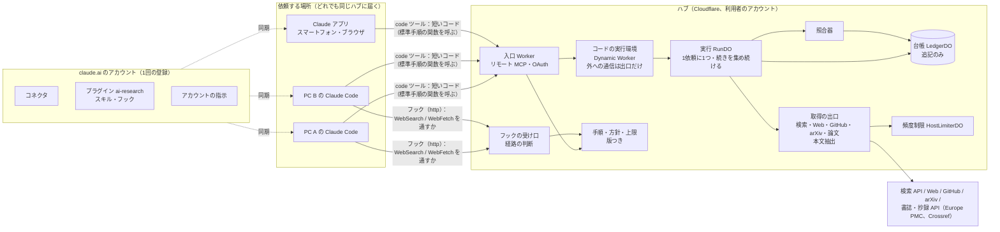

# ai-research：アーキテクチャと設計

- 名前：**ai-research**。ハブ、MCP サーバー、リポジトリの名前に使う

- 版：v1.4（2026-10-25）。v0.2 までの設計を置き換える（作り直し）
- 対象：「調査高速化：やりたいことと制約の宣言」v0.8
- v1.3 からの変更：制約 v0.8 の Q-08（論文・研究の知見は一次資料に届く）・P-06（作業が尽きたら終わる、0件の理由が分かる）・Q-01 の改訂（照合の状態は引用の有無だけを表す、出典の種類が分かる）に合わせて、**論文という出典の種類、関連の絶対の下限、作業の状態で決める終わり、照合の状態の名前**を足した（§3、§8.2）。文献調査のふりかえり29項目を、7つの根本の原因に戻して直した
- v1.2 からの変更：制約 v0.7 の S-06（流し込む量を関係するものに限る）・U-04（往復と形式を問いの重さに合わせる）・P-05（失敗を次の手が決まる形で返す）に合わせて、**依頼の種類・原文の塊・説明の置き場所・境界の失敗**をデータと構造で持つようにした（§3、§8.1、§10）。チャットでの試行3件のふりかえりを、症状ごとの手当てではなく、根本の原因ごとに直した。判断の拠り所は pstack（cursor/plugins）の原則で、どの原則がどの決定を変えたかを §8.1.6 に書いた
- v1.1 からの変更：制約 v0.6 の U-03（調べものがこのシステムの経路を通る）と Q-07（通らなかった結果を示す）に合わせて、**経路に乗せる仕組み**を足した（§7.4〜7.8）。ai-memory（akitaonrails/ai-memory）の、面ごとの対応表と「指示に頼らずフックで確実にする」構造に倣った
- 凡例：【確認済】一次資料で確かめた / 【推論】資料からの推論 / 【要計測】試作で測って決める
- v1.0 からの変更：制約 v0.5 に合わせた。モデルの違いは揺らぎとして扱い、固定しない。Q-06 は照合器による保存の強制で満たすことにし、サブエージェントの案と引きずり試験を外した
- 出典は末尾の番号 [n] で示す
- v0.2 からの作り直しの理由：
  - 制約を v0.4 で要件に立ち返って書き直した。その結果、「会話の外の固定した実行環境（runner、コンテナ）」が不要になった
  - 代わりに、**会話をしている Claude 自身が、ハブの道具を code mode で呼ぶ**形にした

---

## 0. 要旨

1. **調査の道具・記憶・手順は、利用者の Cloudflare 上の「ハブ」1か所に置き、リモート MCP で公開する。** claude.ai にカスタムコネクタとして1回登録すれば、どの PC の Claude Code からも、スマートフォンやブラウザの Claude からも同じハブに届く。→ Q-05, W-03, E-02, U-01, U-02, R-02
2. **モデルの判断は、依頼を受けた会話の Claude がする。** 別の LLM を呼ぶ仕組み（runner、API キー、長期トークン）は持たない。サブスクリプションはそのまま会話の中で使われる。
3. **会話の Claude は、ハブの道具を呼ぶ短いコードを書くだけにする（code mode）。** 検索・取得・本文抽出・台帳の照らし直し・段落選び・打ち切りは、ハブの隔離された実行環境の中で進む。会話に戻ってくるのは、上限付きの小さな束（段落と状態）だけ。→ S-01, S-05, R-01, P-01
4. **調査の手順と常設の方針は、ハブの道具そのもの（関数と説明）に入れる。** どの会話・どの機械から呼んでも同じ手順になる。→ Q-05, Q-06
5. **台帳には出典と原文の短い抜き書きだけ。** 書き込みはハブの照合器経由のみ。会話の Claude が書いた主張は、引用した段落と照合できたものだけが「確認済」になる。→ Q-01〜Q-03, E-01, E-03
6. **最初の結果までに会話の側で回るのは、おおむね3ターン。** 会話が長くても増えない。→ W-01, S-05
7. **調べものをハブの経路に乗せる仕組みを、1つのプラグインにまとめてアカウントに登録する。** 常に読まれる指示（スキル）は全面に、組み込みのウェブ検索を止めて案内するフックは Claude Code と Cowork に効く。止めるかどうかはハブが決め、ハブに届かなければ止めない。経路の外の結果は「経路外」と示す。→ U-03, Q-07, U-01, Q-05

---

## 1. 設計原則

| 原則 | 内容 | 主に効く制約 |
|---|---|---|
| D1 道具と記憶は1か所 | 台帳、取得、頻度制限、手順、方針はハブに置く。機械には何も置かない | Q-05, W-03, E-02, U-01, U-02 |
| D2 重い作業はコードの中、会話には小さな束だけ | 途中結果は実行環境に留め、会話に返すのは上限付きの束だけ | S-01, S-05, R-01 |
| D3 手順は道具に埋め込む | 標準の手順はハブの関数として持つ。会話の Claude は、その関数を1〜2行で呼ぶ | Q-05, Q-06, W-04 |
| D4 持ち込むのは証拠だけ | 台帳に入るのは、その回に取得した原文に文字どおりある抜き書きだけ | Q-02, Q-03, E-01, E-03 |
| D5 主張は段落に縛る | 主張は、ハブが返した段落を引用したときだけ確認済になる。引用のない主張は未確認 | Q-01, Q-06 |
| D6 締め切りは道具の側で持つ | 取得と照らし直しの締め切りはハブの関数が守る。遅れたものは次の呼び出しで差分として返す | W-01, P-01, P-02, Q-04 |
| D7 経路はできる面では強制し、できない面では常に読まれる場所で指示し、どちらも測る | 指示は道具を選ぶ前に読まれる場所（スキルの説明、アカウントの指示）に置く。道具の説明文だけに頼らない。フックがある面では、経路の外の道具をフックで止める | U-03, Q-07 |
| D9 依頼の種類はデータで持つ | 「1つの事実を引く（lookup）」と「調べる（survey）」を依頼の型として持ち、取得の範囲・返す量・続きの有無・締め切りを種類から決める。条件分岐を増やさない | S-06, U-04, W-04 |
| D10 原文は型つきの塊で持つ | 文・箇条・表の行・見出し・コード・メタデータを区別する。段落の候補は文として読める塊だけ。表の行には見出しの行を文脈として添える | S-06, Q-01 |
| D11 説明は内容ごとに1か所 | いつ使うか＝スキルの説明文、手順と API と結果の書き方＝code の道具の説明文、経路外の書き方＝フックの返す文。サーバーの説明文とスキルの本文は、そこを指すだけ。大きさは試験で上限を守る | S-06 |
| D12 失敗は境界で型にする | 実行環境に渡す関数の境界で、内部の失敗を種別（再試行してよいか、次の手）に直して返す。内部では型を信じ、確かめ直さない | P-05 |
| D13 出典の種類はデータで持つ | 論文（`work`）は書誌と抄録を持つ出典の種類にし、書誌・抄録の API から取る。出典ごとに種類（論文・公式・百科事典・その他）を持ち、順位の重みと結果の表示に使う | Q-08, Q-01 |
| D14 関連は絶対の下限も持つ | 最上位との比だけでなく、問いの語にどれだけ当たったかの下限で、関係のない候補を出さない。段落と台帳で同じ判断を使う | S-06 |
| D15 終わりは作業の状態で決める | 走っている作業がなければ終わる。時間の上限は、作業が残っているときの上限。0件のときは理由を状態から決めて返す | P-06, Q-04 |
| D8 経路の判断もハブに置く | フックは受け渡しだけをし、止める・通すの判断と例外はハブの方針として持つ。機械には判断の版を置かない。ハブに届かなければ止めない側に倒れる | U-03, Q-05, U-01 |

---

## 2. 全体構成



### 2.1 部品

| 部品 | 役割 | 状態 |
|---|---|---|
| 入口（リモート MCP） | 道具を公開する。主な道具は `code`（コードを実行する）と、台帳を読む・消す道具。道具の説明に、手順と常設の方針を書く | 持たない |
| コードの実行環境 | 会話の Claude が書いたコードを、隔離された Worker で実行する。外への通信は塞ぎ、ハブの関数と取得の出口だけを渡す | 持たない |
| 実行（RunDO） | 1依頼に1つ。最初の束を返した後も、締め切りまで取得と照合を続け、次の呼び出しに差分を返す。方向転換と予算を管理する | 実行中のみ（全文はメモリだけ） |
| 台帳（LedgerDO） | 抜き書きを追記のみで持つ。取り消しは墓標で表す | 持つ（唯一の正） |
| 照合器 | 抜き書き・引用が原文に文字どおりあるかを調べる | 持たない |
| 取得の出口 | 検索、Web、GitHub、arXiv の取得と本文抽出。要約を挟まない | 持たない |
| 頻度制限（HostLimiterDO） | 取得先ホストごとの許可証。全機械・全アプリの依頼がここを通る | 持つ |
| 手順・方針・上限（版つき） | 道具の説明文、標準手順の関数、常設の方針（アフィリエイト・SEO 目的のサイトを除く、論文や一次資料を優先、など）、上限値、**経路の判断の規則**（§7.6） | 持つ |
| フックの受け口 | Claude Code のフック（http）から呼ばれ、経路の外の道具を止めるか通すかを返す。会話ごとの例外（利用者の明示、ai-research で取れなかった URL）を短い期限つきで覚える。判断の回数を数える（§7.7） | 会話ごとの例外と回数だけ（期限つき） |
| プラグイン `ai-research`（リポジトリに置き、アカウントに登録） | スキル `ai-research-first` と、フックの設定。面ごとに、対応する部品だけが効く（§7.5） | 持たない（設定だけ） |

台帳、実行、頻度制限を Durable Objects にするのは、v0.1 と同じ理由による。名前ごとに1つだけ動き、専用の SQLite を持つので、「1か所で調整する」ものに合う [8][9]。

### 2.2 なぜこの形か

- **code mode の仕組みがそのまま使える。**
  - MCP の道具を型付きの API としてモデルに見せ、モデルが書いたコードを隔離された Worker で動かす仕組みが Cloudflare にある。【確認済】[1]
  - 外への通信は既定で塞がれ、許可する経路だけを外から渡せる。【確認済】[1]
  - 実行の時間上限は既定で60秒。【確認済】[1]
  - コードを動かす Dynamic Workers は、有料プランでオープンベータとして使える。【確認済】[3]
- **途中のデータを会話に通さないと、消費が大きく減る。**
  - Anthropic の例では、15万トークンほどかかっていた処理が約2千トークンになった。【確認済】[2]
  - 代わりに、安全なコード実行環境が要る、という手間が増える。【確認済】[2] それを Cloudflare の仕組みに任せる。
- **ハブから会話のモデルを呼ぶことはできない。**
  - claude.ai のカスタムコネクタは、MCP の sampling（サーバーから会話側のモデルを呼ぶ仕組み）にまだ対応していない。【確認済】[4]
  - そのため、モデルの判断（検索語を作る、主張を書く）は会話の Claude が担う。
- **どこからでも届く。**
  - claude.ai に登録したカスタムコネクタは、スマートフォンのアプリからも使える。ただし追加は claude.ai で行う。【確認済】[4]
  - Claude Code は、claude.ai のログインで使っているとき、claude.ai のコネクタを読み込む。【確認済】[5]
  - したがって登録は1回で済む見込み【推論】。

---

## 3. ハブの API（code mode で会話の Claude に見せる型）

```ts
// 依頼の種類（D9）。種類から、取得の範囲・返す量・続きの有無・締め切りが決まる
type Mode =
  | "lookup"   // 1つの事実を引く。台帳を先に見る。urls があれば検索しない。返す段落は少なく、続きは集めない
  | "survey";  // 調べる（比較・調査）。最初の結果＋続き（作業が尽きるか4分まで）

research.start(q: {
  question: string;          // 解釈した問い。会話を参照しなくても意味が決まる文
  mode: Mode;
  sources?: ("web" | "scholarly")[];   // 既定は ["web"]。論文・研究の知見は "scholarly" を含める（§8.2.2）
  queries?: string[];        // 検索語。lookup で urls があれば省く
  urls?: string[];           // 利用者が示した URL（DOI を含む URL は書誌と抄録で読む）
  scope?: string; exclusions?: string[];
}): Promise<Bundle | HubError>;

research.next(runId, opts?: { waitMs?: number }): Promise<Bundle | HubError>;   // 差分だけ（survey）
research.around(runId, passageId, opts?: { before?: number; after?: number }): Promise<{ sources; passages: Passage[] } | HubError>;   // 段落の前後（§8.2.5）
research.verify(runId, claims: { text: string; cite: { passageId: string; quote: string }[] }[]): Promise<VerifyResult | HubError>;
research.steer(runId, q: { question: string; queries?: string[]; urls?: string[]; sources?: ("web" | "scholarly")[] }): Promise<Bundle | HubError>;
research.deepen(runId): Promise<Bundle | HubError>;   // 利用者が求めたとき（「徹底的に」「網羅的に」を含む。W-04）
research.close(runId): Promise<{ closed: true } | HubError>;   // 作業が残っているうちに止めたいときだけ

ledger.search(text: string): Promise<LedgerHit[]>;

type Tier = "paper" | "official" | "encyclopedia" | "other";   // 出典の種類（D13）
type Source = { kind: "web" | "github" | "arxiv" | "work"; url: string; title?: string; locator: string; tier: Tier;
  work?: { authors: string[]; year?: number; venue?: string; doi?: string; pmid?: string; pmcid?: string } };
type Passage = { passageId: string; sourceId: string; text: string; context?: string };   // context は見出し・導入の文・表の見出し行（照合の対象外）
type LedgerHit = { passageId: string; sourceId: string; excerpt: string;
  status: "引用確認済" | "照合中" | "照合失敗" | "取得できず未照合"; verifiedAt: string };
type Bundle = {
  runId: string; mode: Mode;
  question: { version: number; text: string };
  sources: Record<string, Source>;   // 束に出てくる出典を1回だけ（§8.2.7）
  ledgerHits: LedgerHit[];   // 関連の下限を超えたものだけ。lookup は3件まで
  passages: Passage[];       // lookup は5件まで
  cutoffs: { what: string; why: string; detail?: string; urls?: string[] }[];   // まとめても URL は残す（Q-04）
  progress: { searched: number; found: number; fetched: number; failed: number; running: number };
  done: boolean;             // 作業が尽きたか、4分の上限（D15）
  notices: Notice[];         // { kind: "empty", why, next } など、そのときだけ
};
type ClaimStatus = { index: number;
  status: "引用確認済" | "引用確認済（表記差あり）" | "照合失敗" | "未照合";
  reason?: string; nearest?: { text: string; score: number } };   // 照合失敗のとき、原文でいちばん近い箇所
type HubError = { error: { code: "busy" | "run_not_found" | "bad_input" | "internal"; retryable: boolean; message: string; next: string; runId?: string } };
```

- 台帳の候補で「引用確認済」のものは、その回に照らし直して原文と合っている。lookup で台帳の候補が問いに答えていれば、verify を呼ばずにそのまま答えてよい（U-04）。
- 状態が表すのは「引用が原文にあるか」だけで、主張が引用から正しく導かれるかは表さない（Q-01）。
- 調査ごとに別の RunDO で動くので、`research.start` は `Promise.all` で並べて呼んでよい（§8.2.7）。
- 実行環境の外への通信、台帳への書き込み、束の大きさの上限は v1.2 と同じ。

---

## 4. 処理の流れ

### 4.1 最初の結果まで（目標値。【要計測】）

| 時刻（依頼から） | 会話の Claude | ハブ |
|---|---|---|
| 0〜8秒 | ターン1：依頼を解釈した問いに直し、検索語を決めて `research.start` を呼ぶ | — |
| 8〜33秒 | （待つ） | 台帳の全文検索と照らし直し、検索、取得、本文抽出、段落選びを並列で行う。**25秒の締め切り**で、そこまでの束を返す。RunDO はその後も取得と照合を続ける |
| 33〜48秒 | ターン2：束の段落だけを根拠に主張を書く（書いた主張はその場で利用者に見える）。`research.verify` と `research.next` を呼ぶ | 引用を照合し、状態を返す。照合できた抜き書きを台帳に追記する |
| 48〜55秒 | ターン3：最初の結果として、解釈した問い、主張と状態、出典、打ち切り、利用者への問いを示す | — |

- 利用者が向きを確かめられるのは、ターン2で主張が見え始めた時点（35秒前後）【推論】。W-01 の「向きを確かめられる最初の結果」には、確認済の印が付く前の段階でも足りる。
- 会話の側で回るのは3ターンで、会話の長さに関係なく変わらない（S-05）。長い会話では各ターンの前置きの読み込みが重くなる。それを抑えるのは会話側のプロンプトキャッシュで、Claude Code のサブスクリプション利用（枠内）では、会話本体のキャッシュは既定で1時間保たれる。【確認済】[6]

### 4.2 続き（60〜240秒）

- 会話の Claude は `research.next(runId, { waitMs })` で差分を受け取り、差分の主張だけを書いて照合する。
- ハブは最初の束を返した後も RunDO で取得と照合を続けているので、差分はすぐ返る（P-01）。
- 作業が尽きるか、4分（W-04）か予算で `done: true` になる（D15）。それより先は `research.deepen` を呼んだときだけ。

### 4.3 方向転換（W-02）

- 利用者が向きを変えたら、会話の Claude が `research.steer` を呼ぶ。
- RunDO は進行中の取得のうち新しい問いに関係しないものを止め、問いの版を上げる。取得済みの段落で使えるものは使い回す。

### 4.4 呼び出しの待ち時間

Claude Code は、MCP の呼び出しに応答も進捗もない時間が続くと打ち切る。既定ではネットワーク越しのサーバーで5分。【確認済】[7] 25秒の締め切りで返す設計なので、余裕がある。Claude アプリ側の上限は未確認（§12）。

---

## 5. データモデル

### 5.1 台帳レコード（FactRecord）

| 欄 | 内容 |
|---|---|
| record_id, seq | ULID と、台帳全体で単調に増える番号 |
| source | 種類、正規化 URL、題名、位置（`owner/repo@<sha>:path#L10-24`、`arXiv:xxxx.xxxxxv2 §3.1`、URL＋見出しの道筋） |
| excerpt | 原文そのままの抜き書き。上限300字 |
| context | 照合用の前後の文脈。合わせて400字以内（E-01） |
| fingerprint | ETag、Last-Modified、正規化本文のハッシュ、コミット SHA、arXiv の版番号 |
| verified_at, volatility, origin_run | 確かめた日時、変わりやすさ、書き込んだ実行 |

- 主張・要約・解釈・結論・LLM が付けたタグは持たない（Q-03）。
- 書き込みは照合器経由だけ。会話の Claude が書いた主張は台帳に入らない。主張が引用した段落のうち、原文に文字どおりあると照合できた部分だけが、抜き書きとして入る。

### 5.2 取り消し（墓標）

`{seq, target, reason, at}` を追記する。台帳は1か所なので、どこで消しても全体から消える（U-02）。

### 5.3 実行記録（RunManifest）

| 欄 | 中身 |
|---|---|
| procedure_version | 標準手順の関数・道具の説明文・方針・上限の版 |
| hub_version | 動いている Worker の版 |
| ledger_snapshot_seq | 実行開始時点の台帳の番号。実行中はこれより後の書き込みを読まない |
| question, queries | 解釈した問い（版ごと）と検索語 |
| search_profile, egress | 検索サービスと条件、取得の送信元（ハブ） |
| client | 呼び出し元のアプリと、分かる範囲でモデル名（揺らぎの分析用。比較には使わない） |
| outbound_log | 検索語、取得した URL（E-04） |
| tokens | ハブが会話に返した量、照合に受け取った量（R-01） |

### 5.4 結果

会話の Claude が最初の結果として示す内容は、道具の説明文で決める。

- 解釈した問い
- 主張ごとの状態（引用確認済 / 引用確認済（表記差あり）/ 照合失敗 / 取得できず未照合 / 未照合）と、出典とその種類（§8.2.6）
- 打ち切り
- 利用者への問い

---

## 6. 照らし直し（W-03, Q-02）

v0.1 §5 と同じ規則を、`research.start` の中で、締め切り付きで並列に走らせる。

| 種類 | 確かめ方 | 変わっていなければ | 変わっていれば |
|---|---|---|---|
| GitHub のファイル | パスの最新コミット SHA | 本文を読まずに確認済 | raw で取得し照合 |
| arXiv | 最新の版番号 | 確認済 | HTML 版を取得し照合 |
| Web | 条件付き GET、正規化本文のハッシュ | 確認済 | 照合（完全一致 → 前後の文脈 → あいまい一致） |
| 論文（`work`） | 書誌・抄録の API で取り直し、正規化本文のハッシュ | 確認済 | 照合 |
| 変わりやすいもの | 常に取得 | — | 照合 |

- どれも LLM を使わない。照合が締め切りに間に合わなければ「照合中」、取得できなければ「取得できず未照合」、抜き書きが見つからなければ「照合失敗」として返す（§8.2.6）。
- 変わりやすさは規則で決める。会話の Claude はそれを上げることだけできる。

---

## 7. どこから依頼しても同じにする仕組み（Q-05, Q-06, S-05, U-03, Q-07）

### 7.1 機械ごとに分かれているものの棚卸し（Q-05）

| 制約 v0.5 の Q-05 の項目 | どこにあるか |
|---|---|
| 持ち込める事実 | ハブの台帳だけ |
| 調査の手順 | ハブの標準手順の関数と道具の説明文だけ |
| 道具とその版 | ハブの Worker だけ。機械には何も入れない |
| 取得の条件 | ハブの取得の出口と頻度制限だけ |
| 常設の方針 | ハブの道具の説明文と関数（例：検索結果からアフィリエイト・SEO 目的のサイトを外す処理は、`research.start` の中で行う） |
| 会話で使うモデル | 各会話。違いは制約 §1.3 の揺らぎとして扱う。台帳には原文の抜き書きしか入らないので、持ち込まれる事実には影響しない |

### 7.2 文脈由来の内容を事実にしない仕組み（Q-06）

実際に起きた失敗は、「調査で得た事実を事前の文脈で上書きし、事実として保存した」ことだった（制約 v0.5 Q-06）。この設計では、保存の経路そのものがシステムに握られているので、この失敗は起きない。

- **保存はハブの照合器だけが行う。**
  - 会話の Claude は台帳に直接書けない。
  - 台帳に入るのは、その回に取得した原文に文字どおりある抜き書きだけ。
  - 会話の文脈で書き換えた文は、原文と一致しないので保存されない。
- **確認済の印も照合器が付ける。**
  - 主張が引用した段落 ID が束の中にあり、引用部分が原文にあるときだけ確認済になる。
  - 引用のない主張や、段落にない内容は「未確認」になる。
- **解釈した問いを最初の結果の先頭に出す。** 会話から補った部分を利用者が確かめられる。
- **常設の方針はハブに置く。** 作業場所ごとの CLAUDE.md などの違いで、調査手順が変わらないようにする。

### 7.3 確かめ方

1. **2台・3か所試験：**
   - 試験用の呼び出し器から同じ解釈した問いで依頼する。
   - 実行記録の procedure_version、ledger_snapshot_seq、search_profile が一致することを確かめる。
   - 結果を §1.3 の定義で比べる。
2. **上書き試験：**
   - 会話に調査結果と矛盾する前提を置いてから依頼する。
   - 台帳に、出典の原文にない文が1件も入らないことを確かめる。
   - 確認済の主張に、その前提が現れないことも確かめる。
3. **揺らぎの計測：**
   - 同じ依頼で3回実行し、検索語・出典・主張の重なりを測る。
   - 会話のモデルを変えた場合も同じ方法で測る。
   - 会話の Claude が検索語を作るので、揺らぎはここに出やすい【推論】。

### 7.4 経路から外れる原因（U-03）

試験運用で、ai-research の説明文（「調べものには自分で検索せずこの道具を使う」）が読み込まれていた会話でも、Claude は組み込みのウェブ検索とページ取得を使った（制約 v0.6 U-03 の根拠）。原因は次の3つと見る。

1. **見え方が非対称。** 組み込みのウェブ検索は常に読み込まれている。接続した MCP の道具は、数が多いと遅延読み込みになり、名前しか見えない。サーバーの説明文が届いても、道具そのものは選択肢に並ばない【観察：この開発の会話。ハーネスの説明も、最新の情報にはウェブ検索を使うよう勧めている】。
2. **道具の説明文は、道具を選んだ後にしか効かない。** 選ぶ前に読まれる場所（スキルの説明、アカウントの指示）に書かないと、選択を変えられない。スキルは説明文で選ばれる。【確認済】[12]
3. **面ごとに効く仕組みが違う。** プラグインのスキルとコマンドはどの面でも動くが、フックとサブエージェントは Cowork と Claude Code だけで動き、チャットでは動かない。【確認済】[13]

### 7.5 面ごとの対応表

ai-memory は、エージェントの面ごとに「フックと MCP の両方で動く（Supported）」「MCP だけ（MCP-only。例：Claude Desktop）」を分けて示し、面ごとに約束できることを変えている。【確認済】[15] ここでも同じように、面ごとに使える仕組みと、約束する経路率（制約 v0.6 §2.4）を分ける。

| 面 | 常に読まれる指示 | 経路の外の道具を止める | 経路率の測り方 | 区分 | 目標 |
|---|---|---|---|---|---|
| Claude Code（各 PC のターミナル、デスクトップの Code、クラウドのセッション） | スキル、アカウントの指示 | フック（PreToolUse） | フックの受け口の回数（自動） | 強制できる | 100%（例外を除く） |
| Cowork | スキル、アカウントの指示 | フック | フックの受け口の回数（自動） | 強制できる | 100%（例外を除く） |
| チャット（ブラウザ、デスクトップの Chat、スマートフォン） | スキル、アカウントの指示 | できない | 抜き取りの依頼セット（手動） | 指示だけ | 90% 以上 |

「指示だけ」の面で外れた分は、Q-07 の表示で利用者に見えるようにする。

### 7.6 部品と判断の規則

**登録はアカウントに3つだけ。** どれもアカウントに保存され、各機械では何もしない（U-01）。

| 登録するもの | 中身 | 効く面 |
|---|---|---|
| カスタムコネクタ（済み） | ハブの MCP | 全面。Claude Code も claude.ai のコネクタを読み込む [5] |
| プラグイン `ai-research`（このリポジトリをマーケットプレイスとして追加） | スキル `ai-research-first`、フックの設定 | スキルは全面、フックは Claude Code と Cowork [13]。アカウントに追加したプラグインは、Claude Code に同期される [14] |
| アカウントの指示（Instructions for Claude）に1行 | 「調べものは ai-research で。届かないときだけウェブ検索に戻し、経路外と書く」 | 全面のすべての会話 [16]。ハブに届かないときの振る舞いも、ここでしか伝えられない（§10） |

プラグインにコネクタ（MCP）は入れない。コネクタは既に登録してあり、二重になるのを避ける。

**スキル `ai-research-first`**：説明文を「調べもの・事実確認・最新情報・URL の確認をするとき、頼まれていなくても WebSearch / WebFetch より先に使う」とする。本文には、道具の読み込み方、標準手順の要点、ウェブ検索に戻してよい条件、Q-07 の表示の書き方を書く。手順の詳細はハブの道具の説明文にあり、スキルは入口だけを持つ（D3 と二重にしない）。

**フック（Claude Code と Cowork）**：どれも `http` のフックで、ハブの受け口に送るだけ。判断はハブが持つ（D8）。http のフックは、入力の JSON を POST し、応答は command のフックと同じ JSON の形で返す。【確認済】[17]

| フック | 対象 | ハブがすること |
|---|---|---|
| PreToolUse | `WebSearch`、`WebFetch` | 下の規則で、止める・通すを返す |
| UserPromptSubmit | すべて | 利用者がウェブ検索を明示したか（「ウェブ検索で」「WebSearch」など）を判定し、その会話の例外として期限つきで覚える。依頼文は保存しない |
| PostToolUse | `ToolSearch`、ai-research の道具 | ツール検索で ai-research が見つからなかった会話を、期限つきで覚える。ai-research の道具が使えたら消す |

ai-research で取れなかった URL は、フックではなく RunDO が cutoffs を作るときに受け口へ知らせる（モデルが返す値の形に頼らない）。理由が blocked / timeout / error / unsupported のものだけで、policy と robots は回さない（E-02）。

PreToolUse の判断の規則（上から順に）：

1. その会話で利用者がウェブ検索を明示した → 通す。「経路外（利用者の指定）と結果に書く」を添える（Q-07）
2. `WebFetch` の URL が、ai-research で最近取れなかった URL にある → 通す。「経路外（ai-research で取れなかった）と結果に書く」を添える
3. `WebSearch` で、ai-research の検索が最近使えなかった（検索サービスの失敗・未設定。RunDO が知らせる。10分）→ 通す。「経路外（ai-research で検索できなかった）と結果に書く」を添える（v1.4、§8.2.4）
4. その会話のツール検索で ai-research が見つからなかった → 通す。「経路外（ai-research が使えない）と結果に書く」を添える。ハブには届くが、その面にコネクタがない場合にあたる
5. それ以外 → 止める。理由として、ai-research の `code` の読み込み方と `research.start` の呼び方（URL は `urls` に渡す）を返す。止めた理由はツールのエラーとしてモデルに返り、モデルはそれを見て続けられる【確認済】[17]

**ハブに届かないとき**：http のフックは、接続できない・2xx 以外・時間切れのとき止めない（`onFailure: "block"` を付けたときだけ止める）。【確認済】[17] したがって、ハブが落ちていれば組み込みのウェブ検索がそのまま動く（制約 v0.6 §4 の「止めない側に倒れる」）。そのときの Q-07 の表示は、アカウントの指示とスキルで伝える。

**フックの受け口を守る**：受け口は OAuth を通らない（フックから OAuth はできない）。受け取るのは道具の名前・検索語や URL・会話の ID だけで、台帳には触れない。覚えるのは会話ごとの例外（期限つき）と回数だけ。会話の ID は推測できないので、他人が例外を足しても、その ID の会話にしか効かない。送信の回数には上限を付ける。

実装 v0.1 での確認（2026-10-24、Claude Code 2.1.309 の `claude -p` にプラグインを読み込ませて実施）：

| 試験 | 結果 |
|---|---|
| コネクタあり、道具を指定しない依頼（外の事実が要るもの）4件と、最初の確認の1件 | 5件とも、最初に ai-research を読み込んで `research.start` → `research.verify`。WebSearch を呼ぼうとした回は0。経路率 100% |
| コネクタあり、知識で答えられる依頼1件 | 道具を使わずに答えた（使わなくてよいとき） |
| コネクタなし、道具を指定しない依頼 | スキルが読まれ、ツール検索で見つからず、組み込みの WebSearch が通り、結果に「経路外（ai-research が使えない）」と書かれた |
| コネクタなし、規則 3 を入れる前 | WebSearch と WebFetch が止められ、記憶だけで答えた。規則 3 を足した理由 |
| ハブの計数 | 止めた3、明示で通した1、コネクタなしで通した1、`research.start` 5。試験の回数と一致 |

### 7.7 経路率の測り方

| 面 | 数えるもの | どこで |
|---|---|---|
| 強制できる面 | 止めた回数、例外で通した回数、`research.start` の回数（実行記録の client） | ハブ（自動） |
| 指示だけの面 | 道具を指定しない依頼セット（10件）を出し、ai-research を通ったか、外れたときに Q-07 の表示があったか | 利用者の抜き取り（月1回を目安）【推論】 |

強制できる面で「止めた回数」が多いことは、指示が効いていないことを示す。指示だけの面の経路率を推し量る手がかりにもなる。

### 7.8 採らなかった案

| 案 | 採らない理由 |
|---|---|
| ハブの道具の説明文を強くするだけ | 説明文が読み込まれた会話でも外れた（§7.4）。v1.1 まではこれだけだった |
| 組み込みのウェブ検索を設定で一律に禁止する | ハブに届かないときに調べられなくなる。チャットには禁止する設定がない |
| 機械ごとに CLAUDE.md・設定ファイル・フックのスクリプトを入れる | U-01 に反する。機械ごとに規則の版がずれ、Q-05 にも反する。ai-memory は機械ごとにフックを入れる（`ai-memory run` が初回に自動で入れる）が、それは記録をその機械の中で取るためで、ここでは判断をハブに置けるので要らない【確認済・推論】[15] |
| フックの判断を command のスクリプトで行う | 機械ごとにスクリプトの実行環境（シェル、Node）の違いが出る（利用者の PC には Windows がある）。http なら判断はハブにあり、面の違いが出ない |
| ハブに「web_search」に似た名前の道具を足して選ばれやすくする | 遅延読み込みでは名前しか見えないので一定の効果はありうるが、選ぶ前に読まれる指示（スキル）のほうが確実と見る。経路率が足りなければ試す |

---

## 8. 速さの設計

| 制約 | 設計 |
|---|---|
| S-01 | 途中結果はハブの中。会話に返すのは上限付きの束と差分だけ。調査が長くなっても1回あたりの流入は増えない |
| S-02 | 調査の状態は RunDO にあり、休憩後も `research.next` で続きから受け取れる。会話側のキャッシュは、Claude Code のサブスクリプション利用で既定1時間 [6] |
| S-03 | GitHub は raw 取得とパス単位の API。リポジトリ全体の検索は tarball を展開して行う（大きさの限界は §12）。arXiv は HTML、なければ PDF。Web は直接取得して本文抽出。要約を挟む経路は使わない |
| S-04 | 会話の Claude の仕事を「問いと検索語を決める」「段落から主張を書く」に絞り、重い推論を要しない形にする。思考量そのものは会話の設定なので、ハブからは決められない（§12） |
| S-05 | 最初の結果までの会話側のターン数を3に固定し、流入量にも上限を付ける |
| P-01 | ハブの関数が締め切りで返し、遅れた分は RunDO が集めて差分で返す |
| P-02 | ホストごとの時間上限。同じ実行の中で失敗を覚えて再試行しない。ログイン必須などの構造的な失敗は期限付きで実行をまたいで覚える。打ち切りは cutoffs に出す |
| P-03 | 入口の道具は読み取りと照合だけ。各アプリで1回「常に許可」にする（claude.ai のコネクタ設定、Claude Code の権限設定） |
| P-04 | 道具の説明文で、利用者への問いは結果と一緒に出し、仮の前提を明記して続けるように指示する |

---

### 8.1 会話に流し込む量と往復（S-06、U-04）

#### 8.1.1 根本の原因

チャットでの試行3件（1つの事実を問う依頼）で、会話に入った量の大半が問いに関係しなかった（計測：推定 3,459〜5,820 トークン、精度 0.05〜0.18、2回とも同じ傾向。bench/run_cases.py）。症状は10を超えたが、原因は次の5つにまとまる。

| 原因（最初に誤った判断をした箇所） | 出ていた症状 |
|---|---|
| 依頼の種類を持っていない。1つの事実も調査も同じ流れ・同じ上限・同じ続きで動く | 最低3往復。URL を示しても検索が走る。答えの後も4分集め続ける。続きで段落がまた届く |
| 照らし直しのために取り直した文書を、段落の候補に足していた（`revalidate` → `addDoc`） | 無関係な台帳の候補の出典（他のリポジトリの README など）の段落が束を占めた |
| 台帳の検索が、問いと検索語のすべての語の OR で、関連の下限がない。日本語の長い文をそのまま LIKE の型に入れていた | 無関係な台帳の候補が10件。長い問いで「LIKE or GLOB pattern too complex」 |
| 原文を段落という1種類の塊でしか持っていない | フロントマター、構造化データ、リンク集、見出しだけの断片が段落になった。長い箇条が1つの段落にまとまり、600字で切れた。表の行に見出しがない |
| 説明を、失敗するたびに別の場所に書き足していた | 同じ手順が、アカウントの指示・スキルの本文・道具の説明文の3か所にあった。サーバーの説明文と道具の説明文の中身も同じだった |

#### 8.1.2 依頼の種類（D9）

| | lookup（1つの事実） | survey（調べる） |
|---|---|---|
| 台帳 | 先に見る。関連の下限を超えたもの3件まで | 同じ下限で5件まで |
| 取得の範囲 | urls があればそれだけ（検索しない）。なければ検索語で検索 | 検索語で検索、urls も読む |
| 返す段落 | 5件まで | 12件まで（v1.2 と同じ） |
| 最初の束の締め切り | 15秒（取得の範囲が狭いので） | 25秒（v1.2 と同じ） |
| 続き | 集めない。最初の束で終わる | 4分まで。`close` で止める |
| 会話の側の呼び出し | start →（必要なら）verify。台帳の候補が答えなら start だけ | start → verify＋next → … |

種類はモデルが選ぶ。選び方は code の道具の説明文に1行で書く（1つの事実・1つの URL なら lookup）。

#### 8.1.3 原文の塊（D10）

- 取得の出口で、原文を型つきの塊にする。HTML は要素（`p`、`li`、`tr`、`h1`〜`h6`、`pre`）から、Markdown（GitHub の raw）は行の形から作る。
- 段落の候補にするのは、文・箇条の1項目・表の1行・メタデータ（公開日など、ページの属性の値を原文どおりに書いた行）だけ。見出し、コード、フロントマター、構造化データ（JSON-LD）は候補にしない。
- 見出しと表の見出し行は `context` として添える。照合の対象は `text` だけ（原文に連続して現れる文字列だけを照合するため）。
- 段落の候補は、問いの語に当たったうえで、最上位の点数との比が下限以上のものに限る。

#### 8.1.4 台帳の候補

- 候補を探す語は、段落選びと同じ語の分け方（core の `terms`）を使い、数に上限を付ける。長い文をそのまま型にしない。
- 候補ごとに問いとの関連を点数にし、下限を超えたものを件数の上限まで取る。照らし直すのはその後のものだけ（取得の回数も減る）。
- 照らし直しで取り直した文書は、その候補の照合にだけ使う。段落の候補には足さない。

#### 8.1.5 説明の置き場所（D11）

| 内容 | 置き場所 | 他の場所 |
|---|---|---|
| いつ使うか | スキルの説明文（常に見える） | アカウントの指示に1行（チャットとハブに届かないとき用。利用者が持つ） |
| 手順・API・結果の書き方 | code の道具の説明文 | スキルの本文は「code の道具の説明文に従う」だけ。サーバーの説明文は2行 |
| 経路外の書き方 | フックが返す文（その場で必要なときだけ届く） | code の道具の説明文に1行 |

- 結果の書き方は短くする。確認状態は出典の後ろに「（確認済、出典、確かめた日）」の形で付ける。解釈した問いは会話から補ったときだけ（Q-06）。打ち切りは答えに影響したものだけ（Q-04）。
- 説明の大きさは試験で上限を守る（code の道具の説明文、サーバーの説明文、スキルの本文）。書き足すたびに大きくなる流れを構造で止める。

#### 8.1.6 変更の前後の計測（2026-10-24）

同じ依頼セット（bench/cases/feedback-2026-10-24.json、1つの事実を問う依頼3件）を、Claude Code（`claude -p`、プラグインとコネクタあり）で変更の前後に2回ずつ実行した（bench/run_cases.py）。会話に入った量は、ai-research の道具の結果の推定トークン（道具の説明文の読み込みは含まない）。

| 依頼 | 前（2回） | 後（2回） |
|---|---|---|
| Durable Objects の容量 | 5,177・5,820 | 1,213・1,194 |
| Rust の最新の安定版 | 3,459・3,501 | 1,210・1,019 |
| URL つきの CPU 時間の上限 | 4,380・4,176 | 1,262・2,281 |
| 合計 | 13,016・13,497 | 3,685・4,494 |
| 会話に入った段落・台帳の候補の数（1依頼） | 22 | 6〜12 |
| 答えの長さ（推定トークン、3件の合計） | 1,329・1,494 | 714・719 |
| システムの呼び出し（1依頼） | 2 | 1〜3 |

- 6回中5回で、制約 v0.7 §2.5 の目標（1,500 以下、呼び出し2回以内）に入った。外れた1回（2,281、3回）は、lookup の最初の束で、古いプランの表の行（Bundled plan limit 50 ms）が、答えの行（CPU time per HTTP request 10 ms）より上に並んだため、モデルが `steer` で取り直した。語の頻度だけの順位づけの限界で、§8.1.1 の5つの原因とは別（§12）。
- 精度（根拠に使った段落の割合）は、変更後は測れない。台帳の「確認済」の候補は verify を通さずに根拠にできるようにしたので、verify に渡した ID の数では使った段落を数えられない。前後の比べには、会話に入った量と段落の数を使う。
- 道具の説明文の大きさ（読み込みのたびに入る）は、code の道具が 1,499 → 1,184、サーバーの説明文が同じ手順を重ねていたのを 65 に、スキルの本文が 913 → 146。

#### 8.1.7 拠り所にした原則（pstack）

| 原則 | 変えた決定 |
|---|---|
| Fix Root Causes / Attack the Premise | 10を超える症状を、最初に誤った判断をした5か所に戻して直す（§8.1.1）。締め切りを短くするだけ、件数を減らすだけ、といった症状の手当てをしない |
| Redesign from First Principles | 1つの事実を引く依頼を、最初から依頼の型にあったものとして API と RunDO を作り直す（`depth` をやめて `mode`） |
| Model the Domain / Type System Discipline | 依頼の種類と原文の塊を型で持ち、条件分岐を散らさない |
| Subtract Before You Add / Laziness Protocol | 先に、照らし直しの文書を段落に足す処理と、重なった説明を消す。新しい道具（web.fetch など）は足さず、lookup の型で URL を読む |
| Encode Lessons in Structure | 説明の重なりは、説明の大きさの試験で止める。経路の強制はフックで行い、説明文を書き足さない |
| Boundary Discipline | 失敗は実行環境に渡す関数の境界で型にする（§10） |
| Make Operations Idempotent | `busy` で失敗した `start` は、同じ呼び出しをもう一度すればよい形にする |
| Explain the Number / Prove It Works | 計測の道具（bench/run_cases.py）で、同じ依頼セットを変更の前後で2回ずつ測る。ストレージの時間切れは、何が律速かを測るまで締め切りの調整で隠さない（§12） |
| Sequence Work into Verifiable Units | 引き算 → 境界 → 台帳 → 塊 → 種類 → メタデータの順に、1つずつ試験を通してから次に進む |

### 8.2 論文に届くこと・終わりと理由が分かること・関係のないものを出さないこと（Q-08、P-06、Q-01、S-06）

#### 8.2.1 根本の原因

心理学の文献調査（約20回の調査、13節・約60の主張の文書）のふりかえり29項目を、§8.1 と同じく、最初に誤った判断をした箇所に戻した。29項目は次の7つの原因にまとまる（G の4項目は使い方の問題で、対応する原因の直し方に含めた）。

| 原因（最初に誤った判断をした箇所） | 出ていた症状（ふりかえりの番号） |
|---|---|
| C1 出典を「ウェブのページ」としてしか持っていない。論文は、出版社のページを取得するしかなかった | 出版社のページがほぼ毎回 blocked（1）。学術の検索の経路がない（7）。著者・年・DOI が構造になっていない（8）。根拠の過半が解説記事と百科事典（3） |
| C2 関連の下限が、最上位との比だけ。問いと関係のある候補がひとつもないときも、いちばんましなものが通る。原文の塊が、参考文献の一覧や画面の文言かどうかを知らない | 参考文献の一覧が段落の枠を占める（4）。画面の文言が段落になる（5）。台帳から別の話題の抜き書きが「確認済」で出る（19、20）。問いの意図を外した段落が並ぶ（6） |
| C3 実行の終わりを時間（4分）だけで決めていた。作業が尽きても終わらない。0件のときに、なぜ0件かを持っていない | 続きが空のまま `done` にならない（10）。進み具合が見えない（11）。0件の理由がない（9）。経路外に出てよいかが決まらない（25）。0件で `steer` しない（28） |
| C4 打ち切りをまとめるときに URL を落とした（v1.3 の実装の誤り） | 経路外で読む例外が使えない（2） |
| C5 段落を1つの塊に閉じ、前後をたどる手段がない。導入の文（「次の二つの条件の両方が成り立つとき：」）と続く箇条が別の段落になる | 文の途中で切れる（12）。前後を取り直せない（13）。切り詰めた後に回復できない（26） |
| C6 照合の状態の名前が、主張の正しさに読める。出典の種類を持っていない。照合できなかった理由が1種類 | 「確認済」が主張の保証に読める（14）。大学の抄録と解説ブログが同じ印（15）。写し間違いか表記の差か分からない（16）。取得できなかったものと定説が同じ「未確認」（17） |
| C7 束の形が、出典を段落ごとに繰り返し、予算や通知を常に入れていた。並べて呼んでよいかを書いていない | 応答が重い（23）。1問1調査を逐次に呼んだ（21）。調査の管理が利用者任せ（22） |

主張ごとの照合が重いこと（18）と、照合した日を残さなかったこと（24、29）は、結果の書き方（§8.2.6）で扱う。照合そのものは減らさない（Q-01 を守るため）。

#### 8.2.2 論文という出典の種類（C1、D13）

- 出典の種類に `work`（論文）を足す。`work` は、書誌（著者・年・誌名・DOI、分かれば PMID・PMCID）を1つのメタデータの塊（照合できる書誌の1行）として、抄録を文の切れ目で分けた塊として持つ。本文は、公開の版がある（Europe PMC で `isOpenAccess` が Y で PMCID がある）とき、survey で PMC の記事のページを、今あるウェブの取得経路で読む（新しい形式の読み取りは足さない）。
- 書誌と抄録は、規約が自動の取得を認める API から取る。キーの要らないものから使う（利用者の判断、10/25）。

| 取得先 | 使うもの | 頻度の制限（方針に書く値） | 根拠 |
|---|---|---|---|
| Europe PMC REST | 検索（`resultType=core` で抄録つき）、DOI での引き当て（`DOI:"…"`） | 1秒に5回まで（EBI の公表値はない。利用者の掲示板の 10回/秒 の半分）、同時に2つ | 台帳の確認済の抜き書き（10/25） |
| Crossref REST | 検索（`query.bibliographic`）、DOI での引き当て | 同時に1つ、間隔 250ms（応答の X-Rate-Limit の見出しに従う） | 同上。抄録は出版社が預けたときだけある |
| OpenAlex | 使わない（2026-02-13 からキーが要る。キーがあれば足す） | — | 同上 |

- Crossref の polite pool は連絡先（メールアドレス）を送ると使える。利用者の連絡先を外に送ることになるので、利用者が許すまで送らない（E-04）。送らなくても公開の pool で使える。User-Agent にはリポジトリの URL を入れる。
- 論文の探し方：`research.start` に `sources: ["scholarly"]`（または `["web", "scholarly"]`）を渡すと、検索語ごとに Europe PMC と Crossref を引き、DOI で1つにまとめる。抄録があるものを先に並べる。種類はモデルが選ぶ（論文・研究の知見なら scholarly。code の道具の説明文に1行）。
- 出版社のページが拒んだら DOI に回る：ウェブの検索結果やモデルが示した URL のページが取れず（blocked・unsupported・error・robots。policy は回さない）、URL に DOI が含まれていれば（`…/doi/10.…`、`/article/10.…`）、その DOI で書誌と抄録を引いて出典にする。ページを先に試すのは、公開の全文が読める出版社（PLOS、Frontiers など）で本文を失わないため。取れなかったページの URL は経路の受け口に知らせ、経路外で読めるようにする（束の打ち切りには出さない。答えには論文として出典が出るため）。`doi.org/<DOI>` の URL は最初から書誌と抄録で読む。
- 論文の URL は `https://doi.org/<DOI>` に正規化する。取得の出口は、この URL を書誌の API で読む（照合のための取り直しも同じ経路を通る）。同じ入力から同じ塊ができるように、抄録は Europe PMC を先、なければ Crossref と決めて使う。
- 照らし直し：論文の書誌と抄録はほぼ変わらないので、正規化本文のハッシュで判定する（§6 の表に1行足す）。

#### 8.2.3 関連の下限（C2、D14）

- 下限を2つ持つ。**問いの語にどれだけ当たったか（被覆率）の絶対の下限**と、これまでの最上位との比の下限。両方を超えたものだけを候補にする。関係のある候補がないときは、何も返さない（0件と理由を返す。§8.2.4）。
- 被覆率：問いと検索語のそれぞれについて、区別に効く語（英語の機能語と、ひらがなだけの2文字を除いた語）のうち、候補の文（見出しの文脈を含む）に現れた割合を出し、その最大を使う。下限は方針の値（`relevance.minCoverage`）。
- 同じ判断を、段落の候補と台帳の候補の両方に使う（判断を1か所に置く。`rankRelevant`）。台帳の話題の区切り（名前空間）は作らない（利用者の判断、10/25）。
- 原文の塊に「参考文献」の種類（`ref`）を足し、段落の候補にしない：
  - 見出しが参考文献・脚注・関連項目・外部リンク・出典（References、Notes、See also、External links、Further reading、Bibliography など）の節の中の塊
  - 参考文献の一覧の要素の中の塊（Wikipedia の `references` / `reflist` など、class で分かるもの）
  - 著者・年・題名の並びの形をした箇条（`Gilbert, D. T., … (1993). …`）
  - 照合の全文には残す（原文の順番を変えない）
- 出典の種類で点数に重みを付ける（論文 > 公式 > 百科事典 > その他）。「論文と一次資料を優先する」を説明文の指示から、順位の仕組みに移す（Encode Lessons in Structure）。

#### 8.2.4 終わりと進み具合と0件の理由（C3、C4、D15）

- 実行の終わりを、作業の状態で決める。現在の版で走っている作業がなければ、終わり（`done: true`。深掘りでも同じ）。4分の上限は、作業が残っているときの上限として残す。`steer` と `deepen` は作業を足すので、終わりを取り消す。
  - 終わった実行は、それ以上集めない。`close` は、まだ作業が残っているときに止めるためだけのものになる（多くの実行で呼ばなくてよい）。
- 束に進み具合を付ける：`progress: { searched, found, fetched, failed, running }`（検索した語の数、見つけた候補の数、取得できた出典、取得できなかった出典、走っている作業）。
- 段落も台帳の候補も0件のときは、理由と次の手を通知に入れる（`{ kind: "empty", why, next }`）。理由は束の状態から決める（規則。LLM を使わない）：

| why | 状態 | next |
|---|---|---|
| `no_hits` | 検索したが、候補が見つからない | 検索語を変えて `steer`（論文なら `sources: ["scholarly"]`）。2回続けば0件と伝える |
| `search_failed` | 検索そのものが使えなかった（検索サービスの失敗・未設定） | 組み込みの検索で調べてよい（経路外。フックも10分だけ通す） |
| `all_failed` | 候補はあったが、すべて取得できなかった | cutoffs の URL は経路外で読める（`urls` に入っている） |
| `not_relevant` | 取得できたが、関連の下限を超える段落がない | 検索語を変えて `steer` |
| `still_running` | まだ作業が走っている | `next` を待つ |

- 経路外に出てよい「使えない」は、ai-research で**取れなかった**（`all_failed`）か**検索できなかった**（`search_failed`）ときだけ。見つからない・関係がない（`no_hits`・`not_relevant`）ときは、検索語を変える。組み込みの検索に替えても、同じ問いで見つかるとは限らず、照合もできないため。これを通知の `next` に書く（ふりかえり 25 の基準を、説明文ではなくその場の通知で決める）。
- 打ち切りをまとめるとき、URL を落とさない（`urls`）。まとめた打ち切りの URL も、経路の受け口に「取れなかった URL」として届ける（v1.3 で既にそうしている。束の表示だけが落としていた）。

#### 8.2.5 段落の前後（C5）

- `research.around(runId, passageId, { before, after })` を足す。同じ出典の、前後の候補の塊（既定で前後1つずつ、最大3つずつ）を、照合できる段落として返す。切り詰める前の全文を返す（上限は `limits.aroundMaxChars`）。`deepen` は実行全体、`around` は段落1つ、と粒度で分ける。
- 原文の塊で、「：」「:」で終わる導入の文は、続く箇条の `context` にする（導入の文と条件の本体を同じ候補にする）。導入の文そのものも塊として残す。

#### 8.2.6 照合の状態の名前と出典の種類（C6）

- 状態の名前を、表すものに合わせる（利用者の判断、10/25）。照合が確かめるのは「引用がその原文にあるか」だけで、「主張が引用から正しく導かれるか」は確かめない。

| 新しい名前 | 意味 | 旧 |
|---|---|---|
| 引用確認済 | 引用が原文に文字どおりある | 確認済 |
| 引用確認済（表記差あり） | 記号・空白・幅の違いだけを除けば、原文にある | 確認済（表記差あり） |
| 照合失敗 | 引用が原文に見つからない。理由と、原文でいちばん近い箇所を返す | 未確認（not_in_source など） |
| 取得できず未照合 | 原文を取得できず、照合していない（台帳の候補の照らし直し） | 未確認（取得できない） |
| 未照合 | 引用がない、または予算で照合していない | 未確認（no_citation、budget） |
| 照合中 | 台帳の候補の照らし直しが終わっていない | 照合中 |

- 照合失敗の理由を分ける：`not_in_source`（近い箇所もない）、`marker_mismatch`（記号・空白を除くと同じ並びがあるが、数字か否定が違う）、`near_miss`（あいまい一致の下限に届かない近い箇所がある）。いちばん近い箇所（`nearest: { text, score }`）を返すので、写し間違いか表記の差かが分かる（ふりかえり 16）。
- 出典に種類（`tier`）を付ける：`paper`（論文の書誌・抄録・本文、arXiv）、`official`（方針の一次資料の取得先、GitHub）、`encyclopedia`（百科事典）、`other`。台帳の候補にも付ける（保存せず、出典から決める）。
- 結果の書き方：主張の後ろに「（引用確認済・論文、出典、確かめた日）」。表や長い文書では、主張には番号だけを付け、出典の一覧を末尾に1回だけ書く（状態・種類・確かめた日を一覧に書く）。定説でも照合していなければ「未照合」と書く（強く見せない・弱く見せない、のどちらでもなく、照合したかどうかだけを書く）。

#### 8.2.7 束の形と並べて呼ぶこと（C7）

- 束の出典を `sources: { [sourceId]: Source }` に1回だけ置き、段落と台帳の候補は `sourceId` で指す。
- `budget` は束から外す（止めたときの `budget_stopped` の通知だけにする）。`done` の通知も外す（`done` の値と重なる）。
- 並べて呼ぶ：`research.start` は調査ごとに別の RunDO で動くので、`Promise.all` で並べて呼んでよい。取得先ごとの頻度制限は HostLimiterDO が全体で守る。「一括で始める」関数は足さない（`Promise.all` がそれに当たる。Subtract Before You Add）。
- 調査の管理：終わりを作業の状態で決めるので（§8.2.4）、閉じ忘れても作業は残らない。調査の一覧の道具は足さない。

#### 8.2.8 拠り所にした原則（pstack）

| 原則 | 変えた決定 |
|---|---|
| Fix Root Causes | 29項目を7つの原因に戻して直す。出版社のページの取得を工夫する（User-Agent を変える、再試行する）のではなく、論文を書誌と抄録の出典として持つ |
| Model the Domain | 論文を `work` という出典の種類にし、書誌を構造で持つ。照合の状態を、表すものの名前にする |
| Redesign from First Principles | 実行の終わりを、時間ではなく作業の状態から決める |
| Encode Lessons in Structure | 「論文と一次資料を優先」を、説明文の1行から順位の重みに移す。経路外に出る基準を、0件の通知の `next` に置く |
| Subtract Before You Add | 一括開始・調査の一覧・話題の区切りは足さない。`budget` と `done` の通知を束から外す |
| Boundary Discipline | 外の API の応答は、取得の出口で塊に直す。内部は塊だけを扱う |
| Prove It Works / Explain the Number | 学術の依頼セットで、変更の前後を2回ずつ測る（§8.2.9） |
| Sequence Work into Verifiable Units | 打ち切りと終わり → 関連の下限 → 前後 → 状態の名前 → 論文 → 束の形、の順に1つずつ試験を通す |

#### 8.2.9 変更の前後の計測

（実装の後に書く）

---

## 9. 守るものの設計

| 制約 | 設計 |
|---|---|
| Q-01 | 主張ごとの状態を照合器が返す。結果の見せ方を道具の説明文で決める |
| Q-02 | 台帳の抜き書きは、その回に照らし直せたときだけ確認済（§6） |
| Q-03 | 台帳に主張の欄がない。書き込みは照合器経由だけ（§5.1） |
| Q-04 | cutoffs を束に必ず入れる |
| Q-05 | §7.1 の棚卸し |
| Q-06 | §7.2 |
| U-01 | 導入は claude.ai へのコネクタ登録の1回。Claude Code はログインでそれを読み込む [4][5]。機械を足すときはログインと、道具の「常に許可」だけ |
| U-02 | `ledger.search` / `ledger.forget` / `ledger.export`。SQLite を使う Durable Object は Cloudflare の Data Studio でも中を見られる [10] |
| E-01 | 抜き書き300字＋文脈100字以内。全文は RunDO のメモリだけに置き、保存しない。メモリから退避されたら取り直す。入口は OAuth で利用者本人だけ |
| E-02 | 取得はすべてハブの出口から。HostLimiterDO が全体で許可証を出す。コードの実行環境からの外への通信は塞ぐ [1] |
| E-03 | ・コードの実行環境は外に出られない<br/>・束の段落は「データ」として区切って返し、指示に従わないよう道具の説明文に書く<br/>・台帳への書き込みは照合器経由だけ<br/>・会話の Claude は他の道具（Claude Code の Bash など）も持つので、副作用のある道具は「常に許可」にしない（§12） |
| E-04 | 検索サービスには検索語だけを送る。取得先には GET だけ。送ったものは outbound_log に残す |
| R-01 | ・ハブは、会話に返した量と照合で受け取った量を実行ごとに数える<br/>・上限に近づいたら、それ以上の束を返さずに止めて知らせる<br/>・会話の Claude 自身の消費（思考や出力）はハブから見えないので、§12 で計測方法を決める |
| R-02 | Cloudflare のマネージドな基盤だけ。利用者が保守する常駐サーバーはない。Dynamic Workers のため Workers の有料プランが要る [3] |

---

## 10. 劣化したときの動き

| 状況 | 動き | 結果への表示 |
|---|---|---|
| ハブに届かない | フックは止めない側に倒れ、会話の Claude が自分の道具（Web 検索など）で調べる。台帳は使わない。届くようになったら、そのとき使った出典を `research.start` の対象に含めて取り直し、照合器経由で台帳に入れる | すべて「未確認」。「共有の記憶に届かなかった」と明記 |
| 取得先がハブの送信元を拒む | 取得不能として打ち切る | cutoffs |
| 予算の上限に近い | 束を返さずに止める | 止めた理由 |
| 会話の Claude が書いたコードが失敗する | エラーと正しい呼び方の例を返す。標準手順は1〜2行で書けるようにして、失敗の余地を減らす | — |
| 段落も台帳の候補も0件 | 理由（`no_hits` / `all_failed` / `not_relevant` / `still_running`）と次の手を通知で返す（§8.2.4） | 0件で終わったときは、経路外で調べてよい（理由つき） |
| 出版社のページが取得を拒む | URL に DOI があれば、書誌と抄録の API で読み直す（§8.2.2） | 取れなかったページは cutoffs に URL つきで出る |
| ハブの内部の失敗（Durable Object の過負荷・ストレージの時間切れ・初期化） | 実行環境に渡す関数の境界で `HubError` に直す。`busy` は `retryable: true` で、`next` に「数秒おいて同じ呼び出しをもう一度」と書く。続きを受け取れる `runId` があれば添える | 会話の Claude が、再試行するか経路外に出るかを決められる（P-05） |

ハブに届かないときの振る舞いは、ハブの道具の説明文では伝えられない（届かないので）。アカウントの指示（Instructions for Claude）の1行と、スキル `ai-research-first` で伝える（§7.6）。フックは、ハブに届かなければ止めない（§7.6）。

---

## 11. 制約との対応表

| ID | 満たす設計 | 確かめ方 |
|---|---|---|
| W-01 | 25秒で返す `research.start`、3ターンの流れ（§4.1） | 試験用20件で P95 |
| W-02 | `research.steer`（§4.3） | 途中で解釈を変える試験 |
| W-03 | 中央の台帳と照らし直し（§6） | 機械Aで1回目、機械Bで2回目 |
| W-04 | `depth` と `research.deepen`（§3） | 求めていない深掘りが起きないか |
| S-01 | 束と差分の上限（§3、§8） | 呼び出し回数に対する流入量と応答時間 |
| S-02 | RunDO の状態、会話側のキャッシュ（§8） | 休憩後の最初の応答時間 |
| S-03 | 出典ごとの取得経路（§8） | 出典の種類ごとの取得時間 |
| S-04 | 会話側の仕事を小さくする（§8） | 依頼の種類ごとの応答開始時間 |
| S-05 | 3ターン固定と流入の上限（§4.1） | 長い会話と新しい会話の時間差、ターン数 |
| P-01 | 締め切りで返し、差分で足す（§4.2） | 取得を人為的に遅らせる試験 |
| P-02 | 時間上限と失敗の記憶（§8） | 取得不能な出典を含む試験 |
| P-03 | 読み取りだけの道具と1回の許可（§8） | 承認待ちの回数 |
| P-04 | 道具の説明文での指示（§8） | 質問を含む回で止まった時間 |
| Q-01 | 照合器が主張ごとの状態を返す（§9） | 全主張に出典と状態があるか |
| Q-02 | 照らし直せたものだけ確認済（§6） | 出典を書き換えた試験 |
| Q-03 | 照合器経由の書き込み（§5.1） | 台帳の全件を原文と照合 |
| Q-04 | cutoffs（§3） | 打ち切りを起こす試験 |
| Q-05 | 全部をハブに置く（§7.1） | 2台試験と、機械ごとの状態の棚卸し |
| Q-06 | 照合器だけが保存する、解釈した問いを示す（§7.2） | 上書き試験、3か所試験 |
| U-01 | アカウントへの3つの登録（コネクタ、プラグイン、指示の1行）だけ（§7.6） | 新しい機械・面を足したとき、その機械で行う作業が0件か |
| U-02 | 台帳の道具、墓標（§9） | 1か所で消したものが他で持ち込まれないか |
| E-01 | 抜き書きの上限、全文を保存しない（§9） | 抜き書きの最大長、公開経路の有無 |
| E-02 | ハブの出口と許可証（§9） | 2台同時依頼での arXiv への取得間隔 |
| E-03 | 隔離した実行環境、照合器経由の書き込み（§9） | 指示を仕込んだページでの試験 |
| E-04 | 送る範囲の限定と outbound_log（§9） | 実行ごとの送信記録 |
| R-01 | 流入量の計数と停止（§9） | 依頼ごとの消費トークン |
| R-02 | マネージドな基盤だけ（§9） | 保守が要る常駐プロセスの有無 |
| U-03 | 常に読まれる指示（スキル、アカウントの指示）、フックで止めて案内（§7.5、§7.6） | 強制できる面はハブの回数、指示だけの面は抜き取りの依頼セット（§7.7） |
| Q-08 | 論文の出典の種類と書誌・抄録の API、DOI での読み直し（§8.2.2） | 学術の依頼セットで、一次資料の出典に届いた依頼の割合 |
| P-06 | 作業の状態で決める終わり、進み具合、0件の理由（§8.2.4） | 作業が早く尽きる試験で done になるまでの時間、0件の試験で理由があるか |
| Q-07 | 例外で通すときの添え書き、スキルとアカウントの指示の表示の決まり（§7.6） | 明示の指定・ハブに届かない状態での試験で、表示と理由があるか、台帳が増えていないか |

---

## 12. Known Unknowns

| 項目 | 状態 | 決め方 |
|---|---|---|
| 3ターンで60秒に収まるか | 不明 | M1 で計測。収まらなければ、ハブの締め切りを短くするか、ターン2と3をまとめる |
| 会話の Claude が API を呼ぶコードを、最初から正しく書けるか | 不明 | 標準手順を1〜2行で書けるようにし、失敗率を測る |
| Claude アプリ（スマートフォン・ブラウザ）で、MCP の呼び出しを何秒まで待つか、キャッシュがどう効くか | 不明 | アプリごとに計測 |
| Dynamic Workers の1回あたりの CPU・メモリの上限 | 不明（オープンベータ）[3] | 一次資料を読み、試作で確かめる |
| Worker 上の本文抽出の品質 | 不明 | 同じページ群で他の抽出器と比べる。足りなければ抽出だけ Cloudflare のコンテナで動かす |
| 大きなリポジトリの検索を Worker でできるか | 不明 | 大きさ別に試す。だめなら GitHub のコード検索 API かコンテナ |
| ハブの送信元を拒むサイトの割合 | 不明 | よく使う出典で計測 |
| Durable Object の SQLite で、日本語に効く全文検索ができるか | 不明。SQLite 本体には trigram がある [11] | 試す |
| 会話の Claude 自身の消費トークン（R-01）をどう数えるか | ハブからは見えない | Claude Code の使用量表示や、実行前後の差分で測る方法を試す。見えない分は、ターン数と流入量の上限で抑える |
| 思考量（S-04）を調査のときだけ下げられるか | 会話の設定に依存 | 計測して、問題になるなら手段を探す |
| アカウントに追加したプラグインのフックが、クラウドのセッションと各 PC のターミナルで実際に動くか | 同期されることは確認済 [14]。フックが動くかは未確認 | 登録してから、各面で WebSearch を呼ばせて確かめる |
| チャットで、スキルとアカウントの指示だけで経路率がどこまで上がるか | 不明 | 依頼セットで測る（§7.7） |
| http のフックの受け口に、ハブの公開 URL へ送ってよいか（送信の内容） | 送るのは道具の入力と会話の ID。依頼文はハブで判定して捨てる | 実装で送信内容を記録して確かめる |
| `mcp_tool` のフック（接続済みの MCP の道具を呼ぶ）で、OAuth を使い回せるか | 二次資料ではできるとされる。claude.ai のコネクタの名前でフックから呼べるか、失敗したときに止めないかは未確認 | 使えて失敗時に止めないなら、http の代わりに使う（受け口を OAuth の内側に置ける） |
| ストレージの時間切れ（2026-10-24、3つの依頼を同時に処理したとき）の律速 | RunDO・LedgerDO・HostLimiterDO の呼び出しが、CPU をほぼ使わずに 26〜30 秒待った。`RunDO.start` は壁時計時間 30,021 ms で打ち切られた。何が律速かは分かっていない。遅いストレージ操作の記録を入れた後、計測の12回（3件ずつ並行）では1件も起きていない | 遅いストレージ操作（1秒以上）の記録（`slow_storage`）を見続ける。律速が分かるまで締め切りの調整で隠さない。起きたときは `busy` として返る（§10） |
| 語の頻度だけの順位づけの限界 | lookup で、問いの語を多く含む別の行（古いプランの表など）が答えの行より上に並び、取り直しが起きることがある（§8.1.6） | 依頼セットを増やして頻度を測る。対策の候補は、語の並び（"CPU time" のような2語）の一致を点数に足すこと。測ってから決める |
| 書誌・抄録の API で、心理学の論文の抄録がどれだけ取れるか | Crossref の抄録は出版社が預けたときだけ。Europe PMC は医学・生命科学寄り。APA の誌がどれだけ入っているかは未確認 | 学術の依頼セットで、抄録の取れた割合を測る。足りなければ OpenAlex のキーを利用者に作ってもらう |
| Europe PMC の頻度の上限 | EBI の公表値は見つからない（利用者の掲示板の 10回/秒 だけ） | 1秒に5回で使い、429 が出たら下げる |
| Crossref の polite pool に連絡先を送るか | 利用者の判断待ち（制約 v0.8 §5） | 送らずに公開の pool で使う |
| 会話の Claude が持つ他の道具への注入（E-03） | 束の段落が会話に入るので、理論上は起こりうる | 指示を仕込んだページでの試験。副作用のある道具は常に許可にしない |

---

## 13. 作る順番

| 段階 | 作るもの | 終わりの条件 |
|---|---|---|
| M0 骨組み | 入口（リモート MCP、OAuth）、コードの実行環境、`research.start` の最小版（検索と取得だけ）、claude.ai への登録 | Claude Code とスマートフォンの両方から同じ道具が呼べる。3ターンの所要時間が測れる |
| M1 最初の結果 | 本文抽出、段落選び、照合器、台帳への追記、25秒の締め切り | 試験用20件で、最初の結果まで P95 60秒以内 |
| M2 続きと再利用 | RunDO で続きを集める、`research.next` / `steer`、照らし直し | W-03 の2台試験、Q-02 の書き換え試験、P-01 の遅延試験に通る |
| M3 外部への配慮 | HostLimiterDO、取得不能の扱い、台帳の道具、ハブに届かないときの1行の設定 | E-02、P-02、U-02、オフライン試験に通る |
| M4 一貫性と費用 | 上書き試験、揺らぎの計測（モデル違いを含む）、R-01 の計数、`deepen` | 上書き試験で台帳に原文にない文が入らない。揺らぎの大きさが分かる。R-01 の上限で止まる |
| M5 経路 | プラグイン（スキル、http のフック）、フックの受け口と判断の規則、経路率の計数、アカウントの指示の1行 | 強制できる面で、道具を指定しない依頼の経路率 100%（例外を除く）。ハブを止めた状態で、組み込みのウェブ検索に落ちて「経路外」と表示される。チャットの抜き取りで 90% 以上 |
| M6 流し込む量 | §8.1 の5つの原因の修正（引き算、境界の失敗、台帳の候補、原文の塊、依頼の種類、メタデータ） | 依頼セット（bench/cases/feedback-2026-10-24.json）で、1つの事実の依頼が §2.5（制約 v0.7）の目標に入る。変更の前後を2回ずつ測る |
| M7 論文と終わり | §8.2 の7つの原因の修正（打ち切りと終わり、関連の下限、前後、状態の名前、論文、束の形） | 学術の依頼セット（bench/cases/scholarly-2026-10-25.json）で、変更の前後を2回ずつ測る。一次資料の出典に届いた依頼が増え、0件の束に理由がある。1つの事実の依頼セットが §2.5 の目標から外れない |

---

## 出典

1. Cloudflare Docs「Code Mode（Agents API reference）」https://developers.cloudflare.com/agents/api-reference/codemode
2. Anthropic Engineering「Code execution with MCP」https://www.anthropic.com/engineering/code-execution-with-mcp
3. Cloudflare Changelog「Dynamic Workers, now in open beta」https://developers.cloudflare.com/changelog/post/2026-03-24-dynamic-workers-open-beta/
4. Claude Help Center「Building custom connectors via remote MCP servers」https://support.claude.com/en/articles/11503834
5. Claude Code Docs「Use Claude Code features in the SDK」（claude.ai MCP connectors）https://code.claude.com/docs/en/agent-sdk/claude-code-features
6. Claude Code Docs「How Claude Code uses prompt caching」https://code.claude.com/docs/en/prompt-caching
7. Claude Code Docs「Environment variables」（CLAUDE_CODE_MCP_TOOL_IDLE_TIMEOUT）https://code.claude.com/docs/en/env-vars
8. Cloudflare Docs「Durable Objects Pricing / Limits」https://developers.cloudflare.com/durable-objects/platform/pricing ・ https://developers.cloudflare.com/durable-objects/platform/limits
9. OpenReplay「A Beginner's Guide to Cloudflare Durable Objects」https://blog.openreplay.com/cloudflare-durable-objects-guide/
10. Cloudflare Docs「Durable Objects changelog」（Data Studio）https://developers.cloudflare.com/durable-objects/changelog/
11. simonw/sqlite-fts5-trigram https://github.com/simonw/sqlite-fts5-trigram
12. Claude Help Center「Use skills in Claude」https://support.claude.com/en/articles/12512180-use-skills-in-claude
13. Claude Help Center「Use plugins in Claude」https://support.claude.com/en/articles/13837440-use-plugins-in-claude
14. Claude Docs「Plugins overview」https://claude.com/docs/plugins/overview
15. akitaonrails/ai-memory（README の Support matrix、docs/ARCHITECTURE.md）https://github.com/akitaonrails/ai-memory
16. Claude Help Center「Understanding Claude's personalization features」https://support.claude.com/en/articles/10185728-understanding-claude-s-personalization-features
17. Claude Code Docs「Hooks reference」（HTTP hooks、HTTP response handling、PreToolUse の拒否）https://code.claude.com/docs/en/hooks
